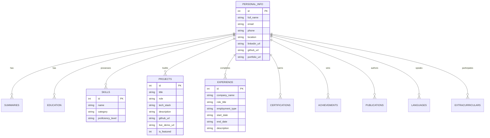

# AI-Powered Portfolio Database and Dynamic Resume Generator

> A production-grade, full-stack application that centralizes verified career achievements in a relational SQLite database, matches qualifications against job descriptions using Google Gemini AI, synchronizes with Google Sheets via real cloud APIs, and compiles ATS-optimized single-column PDF resumes using ReportLab.

---

## 1. Project Overview

The **AI-Powered Portfolio Database & Dynamic Resume Generator** is an end-to-end full-stack software system designed for students and professionals. Instead of manually maintaining multiple divergent Word documents or risking AI hallucination, this system acts as a **single source of truth** for all verified credentials, skills, projects, and work experience.

The system empowers candidates to analyze any job description, evaluate skill alignment, select relevant verified accomplishments using record primary keys, and compile an ATS-friendly (Applicant Tracking System) PDF resume in seconds.

---

## 2. Problem Statement & Objectives

### The Problem
1. **Generic Resume Rejections:** Job seekers apply with one-size-fits-all resumes that fail keyword and competency checks performed by automated Applicant Tracking Systems (ATS).
2. **AI Hallucination Risk:** Asking generic LLM chatbots to "write a resume" frequently results in fabricated credentials, exaggerated metrics, and invented employment history.
3. **Data Fragmentation:** Projects, code repositories, coursework, and certificates are scattered across GitHub, LinkedIn, transcripts, and local notes.

### Objectives
- **Single Source of Truth:** Relational SQLite database with 11 normalized tables storing verified accomplishments.
- **Strict Accuracy Rule:** The AI is strictly constrained to existing portfolio records; it never invents skills, experiences, or awards.
- **Genuine Cloud Integration:** Real Google Sheets API integration using a Google Cloud Service Account (no simulated CSVs).
- **Automated Matching:** Instant gap analysis comparing job description requirements against stored candidate data.
- **Deterministic PDF Generation:** Single-column, ATS-optimized PDF generation with clickable hyperlinks via Python ReportLab.

---

## 3. Core Features

| Feature | Description |
| :--- | :--- |
| **Relational Portfolio Database** | Full CRUD (Create, Read, Update, Delete) across 11 normalized categories with parameterized queries. |
| **Demonstration Profile** | Pre-seeded with verified portfolio records for **Mahek Yadav** (BTech CSE, ITM Skills University). |
| **AI Portfolio Structuring** | Converts unstructured text (bio, notes, transcripts) into structured schema records using Google Gemini 2.5. |
| **Job Description Analyzer** | Parses job postings to extract role requirements, core technologies, and key ATS keywords. |
| **Portfolio Matching Engine** | Calculates match score, highlights verified matching skills, and identifies missing qualifications. |
| **Dynamic ATS Resume Builder** | Interactive checkboxes tracked by database primary keys to selectively include projects, skills, and certifications. |
| **AI Summary Refinement** | Rewrites and tightens professional summaries for the target job role based strictly on verified records. |
| **ReportLab PDF Compiler** | Builds clean, ATS-compliant single-column PDFs with safe filenames and clickable email/GitHub/portfolio links. |
| **Real Google Sheets Sync** | Two-way sync with Google Sheets API v4 using Service Account authentication and in-place updates. |
| **Comprehensive Test Suite** | 11 unit and integration tests covering database operations, AI fallback heuristics, and PDF byte structure. |

---

## 4. Technology Stack & Design Decisions

### Frontend
- **React 18 + Vite:** Fast hot-module replacement (HMR), component-driven UI architecture, lightweight bundle size.
- **Custom Modern CSS:** Accessible, responsive design system with clean light theme (`#f8fafc`), card elevations, badges, and responsive tables.
- **Lucide React:** High-clarity iconography for intuitive navigation.
- **Fetch API Client:** Centralized API client (`api.js`) with structured error interception.

### Backend
- **Python 3.12 + Flask 3.1:** Lightweight, readable RESTful micro-framework ideal for university viva explanations.
- **Flask-CORS:** Configured for cross-origin local development between frontend and backend ports.
- **Python-Dotenv:** Safe isolation of environment variables and credentials.

### Database & Storage
- **SQLite 3:** Serverless, self-contained, zero-configuration relational database with foreign key support and ACID compliance.

### Artificial Intelligence
- **Google GenAI Python SDK (`google-genai`):** Official client for Google Gemini 2.5 Flash with structured JSON schema outputs and graceful local rule-based fallback.

### Cloud Integration
- **Google Sheets API v4 (`google-api-python-client` & `google-auth`):** Genuine enterprise service-account authentication with in-place worksheet updates.

### Document Generation
- **ReportLab 5.1:** Programmatic PDF generation engine with flowables, ParagraphStyles, and ATS-friendly single-column layouts.

---

## 5. Project Folder Structure

```text
portfolio-app/
├── frontend/                          # React + Vite Client
│   ├── public/                        # Static assets and icons
│   ├── src/
│   │   ├── components/                # Reusable UI components
│   │   │   ├── Navbar.jsx             # Top bar with sync and status badges
│   │   │   ├── Sidebar.jsx            # Fixed vertical navigation bar
│   │   │   ├── Modal.jsx              # Reusable modal for CRUD operations
│   │   │   └── Notification.jsx       # Floating toast alert banners
│   │   ├── pages/                     # Application pages
│   │   │   ├── Dashboard.jsx          # Statistics & quick action cards
│   │   │   ├── PortfolioManager.jsx   # Full CRUD tables for 11 categories
│   │   │   ├── AIImport.jsx           # Unstructured text to schema converter
│   │   │   ├── JDAnalyzer.jsx         # Job description parser & gap matcher
│   │   │   ├── ResumeBuilder.jsx      # Checkbox record selector & live preview
│   │   │   └── Settings.jsx           # Google Sheets & Gemini setup guides
│   │   ├── services/
│   │   │   └── api.js                 # Centralized API fetch client
│   │   ├── App.jsx                    # Root state coordinator
│   │   ├── main.jsx                   # React entry point
│   │   └── index.css                  # Responsive design system
│   ├── index.html                     # HTML5 shell
│   ├── vite.config.js                 # Vite server configuration
│   ├── package.json                   # Node dependencies & scripts
│   ├── .env                           # Local frontend environment variables
│   └── .env.example                   # Example frontend template
├── backend/                           # Python Flask Server
│   ├── credentials/                   # Google service account JSON (gitignored)
│   ├── venv/                          # Python virtual environment (gitignored)
│   ├── app.py                         # REST API route controllers
│   ├── database.py                    # SQLite connection & CRUD operations
│   ├── gemini_service.py              # Gemini AI client & fallback heuristics
│   ├── sheets_service.py              # Google Sheets API v4 sync service
│   ├── resume_generator.py            # ReportLab ATS PDF generation
│   ├── schema.sql                     # SQLite 11-table schema DDL
│   ├── seed_data.py                   # Realistic demonstration data seeder
│   ├── generate_sample_resumes.py     # Script to generate sample ML & FE resumes
│   ├── test_suite.py                  # Automated pytest test suite
│   ├── requirements.txt               # Python package dependencies
│   ├── .env                           # Local backend environment variables
│   └── .env.example                   # Example backend template
├── generated_resumes/                 # Destination folder for PDF resumes
│   ├── resume_ml_intern.pdf           # Sample Machine Learning Intern resume
│   └── resume_frontend_intern.pdf     # Sample Frontend Developer Intern resume
├── sample_data/                       # Sample files for immediate testing
│   ├── sample_portfolio.json          # Complete JSON export of demo candidate
│   ├── job_description_ml.txt         # Machine Learning Intern sample JD
│   └── job_description_frontend.txt   # Frontend Developer Intern sample JD
├── screenshots/                       # Demonstration screenshots directory
│   └── README.md                      # Instructions for capturing viva screenshots
├── DEMO_SCRIPT.md                     # 3–5 minute viva presentation video script
├── README.md                          # Master documentation
└── .gitignore                         # Git exclusion rules
```

---

## 6. Database Schema & Table Relationships

The database utilizes SQLite with normalized relational tables:



### Table Definitions
1. **`personal_info`**: Primary candidate contact coordinates and social profiles.
2. **`summaries`**: Professional career summaries with `is_primary` indicator.
3. **`education`**: Institution, degree, major, dates, GPA, and coursework.
4. **`skills`**: Name, category (Languages, Web, ML, Tools, Soft Skills), and proficiency.
5. **`certifications`**: Issuing organization, credential ID, verification URL, dates.
6. **`projects`**: Title, role, tech stack, bullet descriptions, and repository URLs.
7. **`experience`**: Company, role, employment type, location, dates, and responsibilities.
8. **`achievements`**: Awards, honors, hackathons, and issuer details.
9. **`publications`**: Research papers, conferences/journals, authors, and DOIs.
10. **`languages`**: Language and fluency proficiency level.
11. **`extracurriculars`**: Clubs, leadership positions, and volunteer activities.
12. **`system_metadata`**: Key-value registry storing sync timestamps and demo flags.

---

## 7. Prerequisites & Software Installation

Ensure your computer has the following installed:

1. **macOS** (compatible with Intel & Apple Silicon M1/M2/M3/M4)
2. **Python 3.10+** (check via `python3 --version`)
3. **Node.js 18+ & npm** (check via `node -v` and `npm -v`)
4. **Git** (check via `git --version`)
5. **Visual Studio Code** (recommended IDE)

---

## 8. Exact Mac Terminal Setup Commands

Open the **Terminal** app on your Mac (`Command + Space`, type `Terminal`, hit Enter):

```bash
# 1. Navigate to the project root directory
cd /Users/mahekyadav/portfolio-app

# 2. Verify files are present
ls -la
```

---

## 9. Opening in VS Code

You can open the project directly from your terminal:

```bash
code /Users/mahekyadav/portfolio-app
```

Or open VS Code, go to **File > Open Folder...**, and select `/Users/mahekyadav/portfolio-app`.

---

## 10. Python Virtual Environment Setup

Set up an isolated virtual environment for backend Python dependencies:

```bash
# Navigate to backend directory
cd /Users/mahekyadav/portfolio-app/backend

# Create virtual environment named 'venv'
python3 -m venv venv

# Activate the virtual environment
source venv/bin/activate

# Verify python path points to venv
which python
```

---

## 11. Backend Dependency Installation

With the virtual environment active, install all required packages:

```bash
# Upgrade pip to latest version
pip install --upgrade pip

# Install backend dependencies
pip install -r requirements.txt
```

---

## 12. Frontend Dependency Installation

Open a second terminal window or navigate to `frontend`:

```bash
cd /Users/mahekyadav/portfolio-app/frontend

# Install React and Vite dependencies
npm install
```

---

## 13. Environment Variables Configuration

### Backend Configuration (`backend/.env`)
Copy the example file:
```bash
cp /Users/mahekyadav/portfolio-app/backend/.env.example /Users/mahekyadav/portfolio-app/backend/.env
```

Contents of `backend/.env`:
```ini
PORT=5001
FLASK_ENV=development

# Google Gemini API Key (Leave empty to use automatic local fallback mode)
GEMINI_API_KEY=your_gemini_api_key_here

# Google Sheets API Integration
GOOGLE_SERVICE_ACCOUNT_FILE=credentials/service_account.json
SPREADSHEET_ID=your_google_spreadsheet_id_here
```

### Frontend Configuration (`frontend/.env`)
Copy the example file:
```bash
cp /Users/mahekyadav/portfolio-app/frontend/.env.example /Users/mahekyadav/portfolio-app/frontend/.env
```

Contents of `frontend/.env`:
```ini
VITE_API_BASE_URL=http://localhost:5001/api
```

---

## 14. Google Gemini API Setup

1. Visit [Google AI Studio](https://aistudio.google.com/).
2. Sign in with your Google account and click **Get API Key**.
3. Create an API key in a new or existing Google Cloud project.
4. Copy the API key and paste it into `backend/.env`:
   ```ini
   GEMINI_API_KEY=AIzaSy...your_actual_key...
   ```
5. *Note:* If you do not have an API key right now, the application automatically uses its built-in **Local Heuristic Engine**, allowing you to test all AI structuring and matching features without crashing.

---

## 15. Google Cloud & Google Sheets API Setup

This application connects to the **genuine Google Sheets API v4**:

1. Open the [Google Cloud Console](https://console.cloud.google.com/).
2. Create a new project, e.g., `ai-portfolio-project`.
3. In the search bar, search for **Google Sheets API** and click **Enable**.
4. Go to **APIs & Services > Credentials**.
5. Click **Create Credentials > Service Account**:
   - Service account name: `sheets-sync-agent`
   - Grant role: `Project > Editor` (or `Viewer`)
6. Click on the created service account, go to the **Keys** tab, click **Add Key > Create New Key > JSON**.
7. Download the JSON key file.
8. Rename the file to `service_account.json` and place it in:
   ```text
   portfolio-app/backend/credentials/service_account.json
   ```
9. Create a blank Google Sheet in [Google Sheets](https://sheets.new).
10. Click **Share** on your Google Sheet and invite the service account email (found inside the JSON file under `"client_email"`) with **Editor** permissions.
11. Copy the Spreadsheet ID from the URL:
    ```text
    https://docs.google.com/spreadsheets/d/1BxiMVs0XRA5nFMdKvBdBZjgmUUqptlbs74OgvE2upms/edit
                                          ^^^^^^^^^^^^^^^^^^^^^^^^^^^^^^^^^^^^^^^^
    ```
12. Paste the ID into `backend/.env`:
    ```ini
    SPREADSHEET_ID=1BxiMVs0XRA5nFMdKvBdBZjgmUUqptlbs74OgvE2upms
    ```

---

## 16. Database Initialization & Demonstration Seeding

Initialize the database schema and populate realistic demonstration records:

```bash
cd /Users/mahekyadav/portfolio-app
backend/venv/bin/python backend/seed_data.py
```

Output:
```text
Database successfully seeded with realistic demonstration data!
Sample portfolio saved to sample_data/sample_portfolio.json
```

---

## 17. Starting Servers in Separate Terminal Tabs

### Terminal 1: Backend (Flask)
```bash
cd /Users/mahekyadav/portfolio-app/backend
source venv/bin/activate
python app.py
```
*Server runs at:* `http://localhost:5001`

### Terminal 2: Frontend (React + Vite)
```bash
cd /Users/mahekyadav/portfolio-app/frontend
npm run dev
```
*Application runs at:* `http://localhost:5173`

---

## 18. Application URLs

- **Frontend User Interface:** [http://localhost:5173](http://localhost:5173)
- **Backend API Base:** [http://localhost:5001/api](http://localhost:5001/api)
- **Backend Health & Stats:** [http://localhost:5001/api/portfolio/stats](http://localhost:5001/api/portfolio/stats)

---

## 19. How to Use Each Module

### 1. Dashboard
- View total counts for skills, projects, certifications, and experience.
- Check real-time Google Sheets connection status and sync timestamps.
- Use quick-action cards to navigate to workflows or reset demo data.

### 2. Portfolio Manager
- Select any of the 11 category tabs across the top.
- Click **Add New Entry** to create records via structured modal forms.
- Click the pencil icon to edit or trash icon to delete records with instant persistence in SQLite.

### 3. AI Portfolio Import
- Paste unstructured career notes or bio text.
- Click **Fill Sample Bio** to test immediately.
- Click **Convert to Structured Schema**. Gemini maps the text into structured schema records.
- Review the extracted fields, then click **Confirm & Save to Portfolio Database**.

### 4. Job Description Analyzer
- Paste a target job posting or click **Sample ML JD** / **Sample Frontend JD**.
- Click **Analyze JD & Match Portfolio**.
- Review extracted requirements, match percentage score, green verified matching tags, and red missing requirement tags.
- Click **Transfer Match to Resume Builder** to carry the role and matching selections forward.

### 5. Dynamic Resume Builder
- Edit the target job title.
- Click **AI Enhance Summary** to generate an action-oriented summary tailored strictly to verified records.
- Toggle checkboxes to select/deselect specific skills, projects, and certifications.
- Review the live single-column resume paper preview on the right.
- Click **Generate & Download PDF** to compile and download the ATS-friendly PDF.

### 6. System & Integrations (Settings)
- Review Google Gemini SDK and Google Sheets API status.
- Follow the integrated step-by-step setup guides without exposing API secrets.
- Click **Refresh Connection** or **Sync Now**.

---

## 20. How to Sync with Google Sheets

1. Ensure `service_account.json` and `SPREADSHEET_ID` are configured.
2. In the top navbar or Settings page, click **Sync to Sheets**.
3. The Flask backend creates separate worksheets for all 11 categories:
   - *Personal Information*, *Summaries*, *Education*, *Skills*, *Certifications*, *Projects*, *Experience*, *Achievements*, *Publications*, *Languages*, *Activities*.
4. Updates occur **in-place** (clearing and overwriting stale rows) to avoid creating duplicate records.

---

## 21. How to Generate & Download PDFs

1. Open the **Resume Builder** page.
2. Customize selections or leave defaults.
3. Click **Generate & Download PDF**.
4. The backend ReportLab engine compiles the document and saves it in `generated_resumes/`.
5. The browser initiates a download of the clean, ATS-compliant PDF.

---

## 22. Running Automated Tests

Run the comprehensive pytest suite covering database operations, AI fallback heuristics, sheets safety, and ReportLab PDF compilation:

```bash
cd /Users/mahekyadav/portfolio-app
backend/venv/bin/pytest backend/test_suite.py -v
```

All 11 unit and integration tests will execute and pass:
```text
backend/test_suite.py::test_database_seeded_records PASSED
backend/test_suite.py::test_database_crud_cycle PASSED
backend/test_suite.py::test_invalid_category_rejection PASSED
backend/test_suite.py::test_pdf_generation_valid PASSED
backend/test_suite.py::test_safe_filename PASSED
backend/test_suite.py::test_ai_fallback_structure_parser PASSED
backend/test_suite.py::test_ai_fallback_jd_analysis PASSED
backend/test_suite.py::test_sheets_status_without_crash PASSED
backend/test_suite.py::test_api_get_full_portfolio PASSED
backend/test_suite.py::test_api_portfolio_stats PASSED
backend/test_suite.py::test_api_resume_preview PASSED
============================== 11 passed in 0.14s ==============================
```

---

## 23. Troubleshooting Common Errors

### 1. `Port 5000 is in use by another program`
- **Cause:** macOS AirPlay Receiver listens on port 5000 by default.
- **Solution:** Our application is pre-configured to use **port 5001** (`PORT=5001` in `backend/.env` and `VITE_API_BASE_URL=http://localhost:5001/api` in `frontend/.env`).

### 2. `Google Sheets: 403 Forbidden / Caller does not have permission`
- **Cause:** The Google Sheet was not shared with the service account email.
- **Solution:** Copy the `client_email` from your `service_account.json` (or from the Settings page in the UI) and share your Google Sheet with that email as an **Editor**.

### 3. `Gemini API: Invalid API Key or Quota Exceeded`
- **Cause:** Unset or invalid `GEMINI_API_KEY`.
- **Solution:** Verify the key in `backend/.env`. If the key is absent, the backend automatically operates in **Local Heuristic Fallback Mode** so no crashes occur.

### 4. `CORS error in browser console`
- **Cause:** Backend not running or frontend sending requests to incorrect port.
- **Solution:** Ensure the Flask backend is active on port 5001. Check `frontend/.env`.

---

## 24. Security Precautions

- **Backend-Only Secrets:** Gemini API keys and Google service credentials reside exclusively on the server. They are never sent to the React client or bundled in Vite builds.
- **Git Protection:** `.env`, `.pem`, `credentials/`, and `*.db` are strictly ignored in `.gitignore`.
- **SQL Injection Defense:** All SQLite queries utilize parameterized placeholders (`?`) with strict column-name allowlisting.
- **Path Traversal Protection:** PDF filenames are sanitized using regex (`re.sub(r'[^a-zA-Z0-9_\-]', '_', ...)`) and restricted to `generated_resumes/`.
- **Strict Accuracy Rule:** AI outputs are validated against stored candidate records and cannot fabricate unverified qualifications.

---

## 25. Two Job-Specific Resume Demonstrations

The same single verified candidate database is used to generate two genuinely distinct resumes for **Mahek Yadav**:

### Resume A: Machine Learning & AI Tools Intern
- **Target Role:** Machine Learning & AI Tools Intern
- **Prioritized Skills:** Python, C++, Machine Learning (ML), AI Tools & Prompt Engineering, Database Management Systems (DBMS), Computer Networks (CN), Git & GitHub, VS Code, Problem Solving.
- **Selected Projects:**
  1. *AI Prompt Engineering & ML Query Assistant* (Python, Machine Learning, Prompt Engineering, DBMS)
  2. *Summer Hackathon Winning Web Solution* (React.js, Node.js, JavaScript, Git)
- **Selected Experience:** *Web Development & Technical Projects* (ITM Skills University) & *Competitive Hackathons*
- **Selected Certifications:** AI Tools & Prompt Engineering Specialization, Object-Oriented Programming & DSA in C++
- **Research Publications:** Included (*Modern Frontend Architectures and AI Prompt Engineering in Student Workflows*)
- **Generated PDF Path:** `generated_resumes/resume_ml_intern.pdf`

### Resume B: Frontend Developer Intern
- **Target Role:** Frontend Developer Intern
- **Prioritized Skills:** React.js, JavaScript (ES6+), HTML5 & CSS3, Node.js, Vite, RESTful APIs, UI/UX Design, Git & GitHub, Problem Solving, Hackathon Sprint Collaboration.
- **Selected Projects:**
  1. *FashionTech: Interactive UI/UX E-Commerce Experience* (React.js, JavaScript, HTML5, CSS3, UI/UX Design)
  2. *Summer Hackathon Winning Web Solution* (React.js, Node.js, JavaScript, Git)
  3. *Odoo SPIT Hackathon Enterprise Web Portal* (JavaScript, React.js, DBMS, Node.js)
- **Selected Experience:** *Web Development & Technical Projects* & *Competitive Hackathons*
- **Selected Certifications:** Web Development with React and Modern JavaScript, Object-Oriented Programming & DSA in C++
- **Achievements:** Summer Hackathon - Winner, Odoo SPIT Hackathon - Finalist (Top 5), Intra College Hackathon - Finalist (Top 10)
- **Extracurriculars:** Fashion Tech & UI/UX Design Exploration, Web Development & Coding Peer Collaboration
- **Generated PDF Path:** `generated_resumes/resume_frontend_intern.pdf`

To regenerate both sample resumes at any time:
```bash
backend/venv/bin/python backend/generate_sample_resumes.py
```

---

